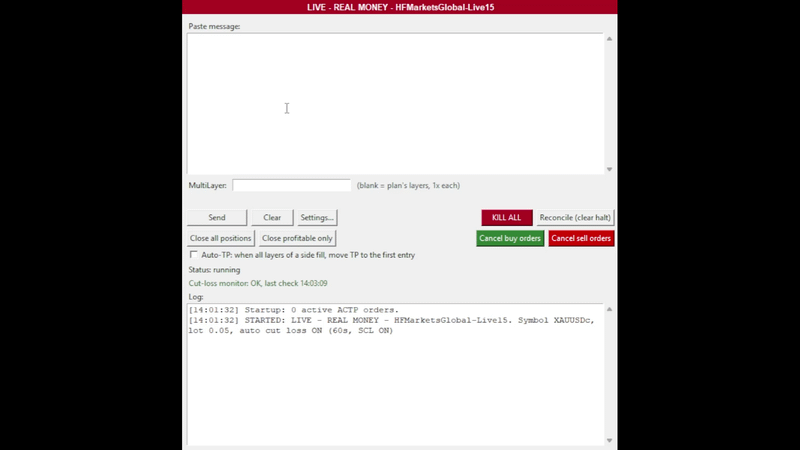

🇮🇩 [Bahasa Indonesia](README.md)

# ACTP – Auto Copy Trade Plan

<p align="center">
  <a href="https://youtu.be/d0bM5Vmml2w">
    
  </a>
</p>

ACTP places a layered set of MT5 pending orders from a trade plan you paste in (or fill in by hand on the **Manual Input** tab), and manages every plan afterwards (Cut Loss, TP updates, re-entry, close buttons, Auto-TP, Auto remove). It never reads WhatsApp for you: you copy and paste each message.

> [!WARNING]
> ACTP places **real orders** on the MetaTrader 5 account that is logged in and can lose money. It comes with **NO WARRANTY** (see the LICENSE file). It is not financial advice and is not affiliated with any signal provider, WhatsApp, MetaQuotes or any broker. You are responsible for every order. Test on a demo account first.

## 🎬 Video tutorial

<p align="center">
  <a href="https://youtu.be/d0bM5Vmml2w">
    
  </a>
</p>

> The video shows v1.0.2. See the [release notes](https://github.com/ALtera21/ACTP/releases) for what is new in v2.1.0.

## 💻 Requirements

Before installing ACTP, make sure you have:

- Windows 10 or Windows 11 (64-bit).
- MetaTrader 5 desktop terminal.
- A hedging MT5 account. On a netting account the layers of one side merge into a single position. ACTP refuses to start on a netting account.
- Algo Trading switched ON in the MT5 toolbar.
- MT5 must be open and logged in whenever ACTP runs.
- Your broker offers an XAUUSD symbol (XAUUSD, XAUUSDc, XAUUSDm, XAUUSD.r and so on).

## 📥 Download

Download the latest ACTP release from the official GitHub Releases page:

**[CLICK HERE TO DOWNLOAD ACTP – LATEST RELEASE](https://github.com/ALtera21/ACTP/releases/download/v2.1.0/dist.zip)**

1. Download the provided `.zip` file under **Assets**.
2. Extract the ZIP file to your preferred directory.
3. Run `ACTP.exe` from the extracted folder. Keep it together with the `_internal` folder; do not move the exe elsewhere or run it from inside the ZIP.

> **Note:** Windows SmartScreen may warn about an unsigned app: “More info → Run anyway”. PyInstaller exes also trigger antivirus false positives.

Example:

```text
C:\ACTP
```

**Verify your download (v2.1.0):** in PowerShell run
```powershell
Get-FileHash .\dist.zip -Algorithm SHA256
```
and compare with: `8ac67652b456764e9b5d6a5fc5634a41f1f46dc65ed34b0f7ca5b1ccd19f4495`

**Updating from v2.0.x:** close ACTP, extract v2.1.0 into a new folder and run it. Your settings and saved state in `%APPDATA%\ACTP` carry over, and plans that are still open keep running. A choice you already saved (for example Auto-TP off) is kept; the new defaults only apply to settings that were never saved.

**Updating from v1.1.0:** the same steps. Plans still open from v1.1.0 keep their old hold-timer Cut Loss.

## 🚀 ACTP setup

1. Open MetaTrader 5, log in, and switch **Algo Trading** ON.
2. Double-click `ACTP.exe`.
3. **First start only:** read the risk notice and click OK. The Settings window opens:
   - Pick your broker's XAUUSD symbol (**Detect from MT5** fills the list).
   - Choose your Cut Loss options (see below).
   - Tick **Create a desktop shortcut** if you want one.
   - Click **Save**. ACTP restarts by itself.
4. The window banner shows which account you're on: **dark blue = LIVE (real money)**, **green = DEMO**, with the server name. Try a demo account first.
5. Set the **Lot** and **Candle** timeframe on the main window, copy a trade plan from WhatsApp, paste it into the box, click **Send**, read the summary, and confirm.

Your settings, logs and saved plans are in `%APPDATA%\ACTP` (`settings.json`, `logs\`, `state\`). To uninstall, delete the ACTP folder and `%APPDATA%\ACTP`.

**Important:** settings can only be saved while MT5 is open, because ACTP checks the symbol and lot against your broker.

## 🖥️ Using ACTP

### Messages ACTP understands

| Message | What ACTP does |
|---|---|
| `PLAN XAUUSDr` with BUY LIMIT and/or SELL LIMIT sections | Starts a **new plan** and places one pending order per layer. Older plans are **not** replaced; each plan lives on its own. |
| `UPDATE XAUUSDr BUY\|SELL` with `SL: a ➜ b` and/or `TP: a ➜ b` | Changes SL/TP on that side of the **most recent** plan that has it. |
| `CLOSE XAUUSDr BUY\|SELL` | Closes the **open positions** of that side in every plan. Pending orders of that side stay. |
| `XAUUSDr BUY\|SELL - Entry ter-fill` | Noted only. Nothing is sent. |

Limits: 2 to 200 layers per side, at most 400 orders per plan, prices with 2 decimals. Pasting the identical text twice within 30 seconds is refused.

### Window controls

| Control | What it does |
|---|---|
| **Paste message** tab | Where you paste the message. |
| **Manual Input** tab | Build a plan by hand (see "Manual Input" below). |
| **MultiLayer** box | Optional. Sets the lot multiplier of each layer and the number of layers for the plan you send next (see "MultiLayer" below). |
| **Layer amount** | How many layers the next plan gets when MultiLayer is empty (2 to 200). |
| **Lot** | Base lot of each order. A change applies immediately and is saved. It is checked against your broker's minimum, step and maximum. |
| **Candle** | Candle timeframe of the Cut Loss for plans you send from now on (M1 to H1). Plans already sent keep theirs. Greyed out when auto cut loss is off or the legacy timer is used. |
| ☾ / ☀ | Switches between the light and dark theme (applies after a restart). |
| **Send** | Parses the message, shows a summary (including how many layers would fill at market right now), and sends it after you confirm. |
| **Clear** | Empties the paste box. |
| **Settings...** | Opens the settings window. Changes apply after a restart (ACTP offers one). |
| **Reconcile (clear halt)** | After a failed operation ACTP stops (status shows HALTED). Check MT5, press this to re-read it, then Send the same message again to resume. (Think of this as a refresh button) |
| **KILL ALL** | Cancels every pending ACTP order and closes every open ACTP position, in every plan. |
| **Close all positions** | Closes open positions only. Pending orders stay. |
| **Close profitable only** | Closes only the positions currently in profit. Spread is counted; swap and commission are not. |
| **Cancel buy orders** / **Cancel sell orders** | Cancels the **pending** orders of that side in all plans. Open positions stay open and keep their SL/TP and Cut Loss protection. Does not run while HALTED: press Reconcile first. |
| **Update TP also changes pending orders** checkbox | Next to the Live plans title. Off: the ↻ Update TP button changes open positions only. On: pending orders get the new TP too. Remembered. On by default. |
| **Auto-TP** checkbox and box | "Auto-TP: when price is [100] % into a side's range, move TP to proximal". See "Auto-TP" below. Remembered. On by default. |
| **Auto-TP is prioritized over manual TP update** checkbox | Lets Auto-TP replace a TP you set by hand (hover the ⓘ). Remembered. On by default. |
| **Auto remove** checkbox and box | "Auto remove PLAN's side that has 0 positions open and [90] % into a side's range". See "Auto remove" below. Remembered. Off by default. |

Most of these ask you to confirm first; see "Popup confirmation" below.

> [!NOTE]
> ACTP only touches orders it placed. Your own manual trades are never modified.

<p align="center">
  
</p>

<p align="center">
  
</p>

### Live plans

Every plan you send gets a name: **Alpha, Beta, Gamma … Omega** (then a short random id). The **Live plans** table shows one row per plan with its time sent, BUY and SELL orders (filled / pending, Cut Loss) and its candle countdown. The same name is in the MT5 order comment, for example `1763440000-Alpha:3` (time sent, plan name, layer number).

Each side of a row has a **TP box**, a **↻ Update TP** button and a **⇄ re-entry** button, followed by the ✕ buttons (hover any button to read what it does):

| Button | What it does |
|---|---|
| **TP box** + **↻** | Shows the TP in force. Type a new price and press ↻ (or Enter) to change the TP of that plan side only. See "Manual TP". |
| **⇄** | Re-enters that side on the same range. See "Re-entry". |
| green **✕** beside BUY | Cancels that plan's pending BUY orders and closes its open BUY positions. |
| red **✕** beside SELL | The same for SELL. |
| dark **✕** at the end of the row | Cancels the entire plan and closes all its positions. |

Other plans are never touched. The ✕ buttons keep working while ACTP is HALTED. After a bulk action (KILL ALL, Close all / profitable, Cancel PO, the plan ✕ buttons) the log shows "Took x.x s.".

If you click outside the Live plans table while a new TP is typed in a box, the box goes back to the TP in force.

The **timer box** next to the status lines shows the timeframe in use, the time left until the candle closes and the plan name. The number goes from green to yellow to red as the candle is about to close. It also runs while no plan is live (then it shows the timeframe the next plan will use).

### Manual TP

Type a price in the TP box of a plan side and press **↻** (or Enter). Only that plan and that side change.

- Only **open positions** get the new TP. Tick **Update TP also changes pending orders** to change the pending orders as well.
- A TP **inside the range** (or anywhere MetaTrader refuses) works too. ACTP then watches the price once a second and, when it reaches the TP (BUY: bid ≥ TP, SELL: ask ≤ TP), closes the **open positions** of that side. Pending orders are left alone. A level ACTP is watching is shown in orange. It survives closing and reopening ACTP and works once only.
- If the price is **already past** the TP and positions are open, ACTP asks first, because they would close at once. This question can be switched off like the other popups.
- With **no position open yet**, the TP is kept and watched, and MT5 is not changed (tick the pending-orders box to also put it on the pending orders). It acts once positions open and the price is at the TP.
- A TP set by hand replaces Auto-TP for that plan side, unless **Auto-TP is prioritized** is ticked.

### Re-entry

The **⇄** button of a side opens a small window beside it with the side's old range and its pips, and two choices:

- re-entry with the **same layer amount and lot as before**, or
- re-entry with the **current layer amount and lot** (the boxes on the main window).

The side's pending orders are cancelled, its open positions are closed, and the layers are placed again on the same range. The plan keeps its name, Cut Loss, SL and TP. The other side and other plans are not touched. It asks "are you sure?" first. The window closes by itself when you use another application. While Auto-TP is on, it also shows the price at which Auto-TP will move the TP ("TP proximal when prices hit ...").

### Auto-TP

**Auto-TP: when price is [100] % into a side's range, move TP to proximal.** `proximal` is the first entry (BUY: the highest layer, SELL: the lowest); `distal` is the last one, closest to the Cut Loss.

- **0%** is the proximal end of the side's range and **100%** the distal end. The box takes 1 to 100 and is remembered; 100 means the price reached the last layer.
- ACTP follows the price once a second (a BUY side follows the ask, a SELL side the bid) and remembers the **deepest point** the price reached, so a dip that comes back still counts. The memory is saved, so restarting ACTP does not forget it. Hover the ⓘ next to the line.
- At least one position must be open. The TP of every open and pending order of that side then moves to proximal. Once per plan and side, each plan on its own.
- A side whose TP you set by hand (the ↻ button, or dragging it in MetaTrader) is left alone. Tick **Auto-TP is prioritized over manual TP update** and Auto-TP replaces it anyway, and ACTP stops watching a level you set by hand on that side.

Example: BUY range 3443.00 - 3439.87. At 70% the price is 3443.00 − 0.70 × 3.13 = 3440.81.

### Auto remove

**Auto remove PLAN's side that has 0 positions open and [90] % into a side's range.** When the price has been at least that far into a side's range (the same deepest-point memory as Auto-TP) and that side has **no open position left**, its leftover pending orders are cancelled. Example: 6 layers, Auto remove at 80%. The price went back, 4 layers filled and were closed (TP or by hand): the other 2 layers are cancelled.

- A side that still has an open position is never touched; ACTP waits until the last one is closed.
- A side the price never went deep into is never touched.
- The other side and other plans are not touched.
- Off by default; the percent box takes 1 to 100 and is remembered.

### Manual Input

The **Manual Input** tab lets you build a plan without a WhatsApp message. Fill in the **range** (the two prices) of the side or sides you want, SELL on top and BUY below; a side with an empty range is left out. Leave **Cut loss**, **Stop loss** or **Take profit** empty to use the default shown next to the box:

| Price | Default |
|---|---|
| Cut loss | 30% of the range width beyond the far end of the range |
| Stop loss | **Manual SL = x range** (Settings, default 3) times the range width beyond the far end |
| Take profit | One range width past the top layer |

**One price per side.** Instead of two ranges you can type just **one price on the SELL side and one on the BUY side** (either box) and press **add both buy and sell PO range**. The SELL price is the ceiling (sell distal) and the BUY price is the floor (buy distal). The TP of both sides is exactly in the middle, and each proximal end sits halfway between its distal end and the TP. With 0 = floor and 1 = ceiling, and the default Stop loss multiple of 3, the levels are: Stop loss -0.75, Cut loss -0.075, BUY distal 0, BUY proximal 0.25, TP 0.5, SELL proximal 0.75, SELL distal 1, Cut loss 1.075, Stop loss 1.75. Grey hints beside the boxes show the worked-out range and TP before you send.

Layers and lots come from the **Layer amount** and **MultiLayer** boxes. The tab writes a normal `PLAN` text and sends it through the same checks as a pasted message, so you get the same summary and confirm popup.

<p align="center">
  
</p>

### MultiLayer

The **MultiLayer** box under the paste box lets you choose the size of every layer, and how many layers there are, for the next plan you send. Type one number per layer, for example `1, 1, 1, 1, 2, 2`. Each number multiplies the **Lot** (the base lot).

| Base lot | MultiLayer | Result |
|---|---|---|
| 0.06 | `1, 1, 1, 1, 2, 2` | 6 layers: 0.06 x 4, then 0.12 x 2 |
| 0.06 | `1, 1, 1, 2` | 4 layers: 0.06 x 3, then 0.12 x 1 |

<p align="center">
  
</p>

> The GIF shows v1.0.2. See the [release notes](https://github.com/ALtera21/ACTP/releases) for what is new in v2.1.0.

- **Layer 1 is the first price the market reaches** (BUY: the highest entry, SELL: the lowest entry). The larger lots in the examples above are the deepest layers.
- The list sets the layer count too. ACTP spreads that many layers evenly across the plan's area, whatever number of layers the message says.
- **Leave the box blank** and ACTP uses the **Layer amount** box: that many layers, one base lot each (or your **Saved MultiLayer** for that amount, see below).
- The same list is used for BUY and SELL. It is ignored by UPDATE and CLOSE messages.
- Use 2 to 200 numbers, each above 0 and at most 10. Decimals such as `1.5` are fine if the resulting lot is a multiple of 0.01. A plan can hold at most 400 orders in total.
- The Send summary lists the lot of every layer and the total per side. ACTP also checks the lots against your broker's minimum, step and maximum before anything is sent.
- The box is **not saved** and is **not cleared after Send**. While it is filled, an orange line below it shows the lots that will be used.
- If a plan is interrupted (HALTED), Send the same message again with the **same** MultiLayer value to resume it. A different value starts a new plan.
- **Max layers at market per side** counts layers, not lots, so a larger layer counts the same as a small one.

**Saved MultiLayer** (Settings → **Saved MultiLayer...**): save a list for a layer amount, for example 4 layers = `1, 1, 1, 2`. Whenever the MultiLayer box is empty and the Layer amount is 4, that list is used. A layer amount with no saved list uses 1x for every layer. A list typed in the MultiLayer box always wins.

### Late plans

If you paste a plan after price has already moved into it, layers whose entry is already reached are bought **at market** instead of failing. The Send summary shows the split. The plan is refused when:
- more layers than **Max layers at market per side** would fill at market, or
- price is already through that side's Cut Loss or SL.

### Cut Loss

With **Auto cut loss** on, ACTP closes a whole side of a plan (cancels pending, closes open) as soon as the rule below is met. Each plan keeps the rule and timeframe it was sent with, so changing the settings later does not change plans that are already live.

**Candle close (default).** A candle of your chosen timeframe must **close** beyond the plan's Cut Loss (BUY: below it, SELL: above it). Only candles that opened **after** the plan was sent count, and a price spike that comes back before the candle closes does nothing. Pick the timeframe in the **Candle** box (M1, M2, M3, M4, M5, M6, M10, M12, M15, M20, M30, H1). The timer box counts down to the close of the running candle. The countdown follows the last price tick, so it can be a few seconds off in a quiet or closed market.

**Legacy timer (optional).** Tick **Use the legacy timer instead** in Settings to go back to the v1 rule:
1. price (BUY: bid, SELL: ask) stays beyond the plan's Cut Loss for the **hold time** without interruption, **and**
2. with **SCL** on, price is also at or beyond the Stop Cut Loss line at that moment.

SCL sits between the Cut Loss and the SL, at the chosen percentage of the way from Cut Loss to SL. A gap of more than 15 seconds between price checks restarts the timer.

With auto cut loss **off**, nothing closes a side automatically: only the broker's SL/TP, KILL ALL, or you.

**Cut Loss, Auto-TP, Auto remove and the TP watch only run while the ACTP window is open.** Closing it asks for confirmation, because monitoring stops. Orders keep their SL/TP at the broker.

### Popup confirmation

Settings has a red **Popup configurations (Dangerous settings)** box. **Popup confirmation** is the master switch and **Configure each popup...** opens one checkbox per action: Send plan, Cancel PO buy / sell, KILL ALL, Close all positions, Close profitable only, the plan-table buttons (cancel one side, cancel the plan, re-entry, Update TP when the price is already past it) and Quit. They are all ticked by default, which means a normal OK / Cancel popup.

**Unticking** a box (or the master box) first asks you to type a random 5-digit code. After that, the action runs immediately with **no popup at all**, so only do this if you accept the risk of an accidental click. Ticking a box again needs no code.

### Language and theme

- **Language:** Settings → **Language**: English or Bahasa Indonesia. Applies after a restart. Detailed error texts from the broker and the parser stay in English.
- **Theme:** the ☾ / ☀ button on the right of the Layer amount row switches light and dark. Applies after a restart.

### Logo

The logo in the title bar and taskbar is set in `logo.py` (a picture file or an emoji). To also change the icon of the `.exe`, see `make_icon.py` (build instructions are in its first lines).

## 📋 Trading Configuration

Set these in **Settings...** (or on the main window where noted). Defaults are shown.

| Setting | Default | Allowed | Meaning |
|---|---|---|---|
| XAUUSD symbol | `XAUUSDc` | Any XAUUSD variant (`XAUUSD`, `XAUUSDm`, `XAUUSD.r`, ...) | The only symbol ACTP will trade. Messages always say `XAUUSDr`; that is the provider's name, not yours. |
| Lot (main window) | 0.01 | 0.01 to 10, steps of 0.01 | Volume of each layer (the base lot that MultiLayer multiplies). Must fit your broker's limits. |
| Layer amount (main window) | 6 | 2 to 200 | Number of layers of the next plan when MultiLayer is empty. |
| Candle (main window) | M1 | M1 to M6, M10, M12, M15, M20, M30, H1 | Candle timeframe of the Cut Loss for new plans. |
| Auto-TP | On | On / Off | See "Auto-TP". Main window. |
| Auto-TP percent | 100 | 1 to 100 | How far into a side's range the price must go. Main window. |
| Auto-TP is prioritized | On | On / Off | Auto-TP also replaces a TP set by hand. Main window. |
| Update TP also changes pending orders | On | On / Off | Main window, next to the Live plans title. |
| Auto remove | Off | On / Off | See "Auto remove". Main window. |
| Auto remove percent | 90 | 1 to 100 | Main window. |
| Max layers at market per side | 3 | 0 to 200 | See "Late plans". |
| Manual SL = x range | 3 | 0.1 to 100 | Default Stop loss distance of the Manual Input tab. |
| Auto cut loss | On | On / Off | See "Cut Loss". |
| Use the legacy timer | Off | On / Off | Use the hold-timer + SCL rule instead of candles. |
| Hold time | 60 s | 10 to 3600 | Legacy timer only: how long a Cut Loss breach must last. |
| SCL | On | On / Off | Legacy timer only: price must also reach the Stop Cut Loss line. |
| SCL distance | 15 % | 5 to 95 | Legacy timer only: how far from Cut Loss toward SL the SCL line sits. |
| Popup confirmation | All On | per action | See "Popup confirmation". |
| Language | English | English / Bahasa Indonesia | Window language. |

Your symbol must have at least 2 price decimals.

<p align="center">
  
</p>

> **Note:**
The lot size advertised in the original WhatsApp trading plan is ignored. ACTP uses its own configured volume.

## ⚠️ Important Notes

- ACTP has no dry-run mode. Test on a demo account first, one copy per account, keep PC awake and window open, check banner and server, risks are yours.
- Ensure your MT5 terminal is connected to the correct trading account.
- Never use an unverified release for live trading.
- Bulk closes and cancels are sent with 8 parallel workers. The "Took x.x s." line in the log tells you how long each one took.
- Trading involves financial risk. You are responsible for configuring and monitoring your trading environment.

## 🐛 Troubleshooting

| Message | What to do |
|---|---|
| `Cannot start: ...` | Open MetaTrader 5, log in, turn on Algo Trading, then start ACTP again. |
| `Cannot read your settings file` | Fix or delete `%APPDATA%\ACTP\settings.json`. |
| `Status: HALTED` | Check MT5, press **Reconcile**, then Send the same message again to resume. To get rid of one plan, use its dark **✕** button in the Live plans table. |
| Windows blocks the app | More info → Run anyway (see Download). |
| This account is not a HEDGING account | Use a hedging account. Ask your broker. |
| The logo does not change | Restart ACTP. An emoji logo needs Pillow; use a PNG file instead (see `logo.py`). |

**Logs:** ACTP writes one log file per day to `%APPDATA%\ACTP\logs\actp.log` (30 days kept). Paste `%APPDATA%\ACTP\logs` into the File Explorer address bar to open the folder. If you report a problem, attach the relevant lines. They contain your broker server name, order tickets and prices, so look them over before posting publicly.

Bugs and questions: open an issue on the GitHub repository.

## 📄 License

See the repository's LICENSE file for licensing and usage conditions.
