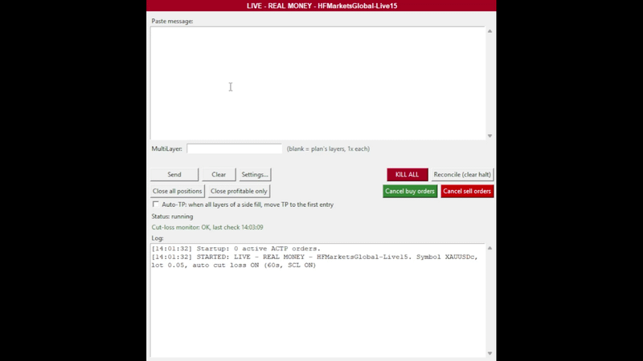

🇬🇧 [English](README.gb.md)

# ACTP – Auto Copy Trade Plan

ACTP memasang sekumpulan pending order MT5 berlapis (layer) dari trade plan yang kamu tempel, lalu mengelolanya setelah itu (Cut Loss, tombol close, Auto-TP). ACTP tidak pernah membaca WhatsApp untukmu: kamu menyalin dan menempel setiap pesan sendiri.

> [!WARNING]
> ACTP memasang **order sungguhan** di akun MetaTrader 5 yang sedang login dan dapat menyebabkan kerugian. ACTP diberikan **TANPA GARANSI** (lihat file LICENSE). Ini bukan nasihat keuangan dan tidak berafiliasi dengan penyedia sinyal, WhatsApp, MetaQuotes, maupun broker mana pun. Kamu bertanggung jawab atas setiap order. Coba dulu di akun demo.

## 🎬 Video tutorial

<p align="center">
  <a href="https://youtu.be/d0bM5Vmml2w">
    
  </a>
</p>


## 💻 Persyaratan

Sebelum memasang ACTP, pastikan kamu punya:

- Windows 10 atau Windows 11 (64-bit).
- Terminal desktop MetaTrader 5.
- Akun MT5 bertipe hedging. Pada akun netting, layer dalam satu sisi menyatu menjadi satu posisi. ACTP menolak berjalan di akun netting.
- Algo Trading dalam keadaan ON di toolbar MT5.
- MT5 harus terbuka dan sudah login setiap kali ACTP berjalan.
- Brokermu menyediakan simbol XAUUSD (XAUUSD, XAUUSDc, XAUUSDm, XAUUSD.r, dan sebagainya).

## 📥 Unduh

Unduh rilis ACTP terbaru dari halaman GitHub Releases resmi:

**[KLIK DI SINI UNTUK MENGUNDUH ACTP – RILIS TERBARU](https://github.com/ALtera21/ACTP/releases/download/v1.1.0/dist.zip)**

1. Unduh file `.zip` yang tersedia di bagian **Assets**.
2. Ekstrak file ZIP ke folder pilihanmu.
3. Jalankan `ACTP.exe` dari folder hasil ekstrak. Biarkan tetap bersama folder `_internal`; jangan memindahkan exe ke tempat lain atau menjalankannya dari dalam ZIP.

> **Catatan:** Windows SmartScreen mungkin memperingatkan bahwa aplikasi ini belum ditandatangani: “More info → Run anyway”. Exe buatan PyInstaller juga sering memicu false positive pada antivirus.

Contoh:

```text
C:\ACTP
```

**Verifikasi unduhanmu (v1.1.0):** di PowerShell jalankan
```powershell
Get-FileHash .\dist.zip -Algorithm SHA256
```
lalu bandingkan dengan: `6b106a8917b86770f9ac3955bbe26cf7a21a169a882cd6383a269bd817f5a16c`

## 🚀 Pengaturan ACTP

1. Buka MetaTrader 5, login, dan nyalakan **Algo Trading**.
2. Klik dua kali `ACTP.exe`.
3. **Hanya saat pertama kali dijalankan:** baca pemberitahuan risiko dan klik OK. Jendela Settings akan terbuka:
   - Pilih simbol XAUUSD milik brokermu (**Detect from MT5** mengisi daftarnya).
   - Atur lot per order.
   - Pilih opsi Cut Loss (lihat di bawah).
   - Klik **Save**. ACTP akan restart sendiri.
4. Banner di jendela menunjukkan akun yang sedang dipakai: **merah = UANG ASLI**, **hijau = DEMO**. Coba dulu di akun demo.
5. Salin trade plan dari WhatsApp, tempel ke kotak, klik **Send**, baca ringkasannya, lalu konfirmasi.

Pengaturan, log, dan plan yang tersimpan berada di `%APPDATA%\ACTP` (`settings.json`, `logs\`, `state\`). Untuk menghapus ACTP, hapus folder ACTP dan `%APPDATA%\ACTP`.

**Penting:** pengaturan hanya bisa disimpan saat MT5 terbuka, karena ACTP memeriksa simbol dan lot terhadap brokermu.

## 🖥️ Menggunakan ACTP

### Pesan yang dipahami ACTP

| Pesan | Yang dilakukan ACTP |
|---|---|
| `PLAN XAUUSDr` dengan bagian BUY LIMIT dan/atau SELL LIMIT | Menggantikan plan saat ini pada sisi tersebut dan memasang satu pending order per layer. |
| `UPDATE XAUUSDr BUY\|SELL` dengan `SL: a ➜ b` dan/atau `TP: a ➜ b` | Mengubah SL/TP pada order di sisi tersebut. |
| `CLOSE XAUUSDr BUY\|SELL` | Menutup **posisi yang sedang terbuka** pada sisi tersebut. Pending order di sisi itu tetap ada. |
| `XAUUSDr BUY\|SELL - Entry ter-fill` | Hanya dicatat. Tidak ada yang dikirim. |

Batasan: 2 sampai 20 layer per sisi, paling banyak 12 order per plan, harga dengan 2 desimal. Menempel teks yang persis sama dua kali dalam 30 detik akan ditolak.

### Kontrol di jendela

| Kontrol | Fungsinya |
|---|---|
| **Paste box** | Tempat menempel pesan. |
| Kotak **MultiLayer** | Opsional. Menentukan lot setiap layer dan jumlah layer untuk plan yang kamu kirim berikutnya (lihat "MultiLayer" di bawah). Kosong = jumlah layer sesuai plan, masing-masing satu base lot. |
| **Send** | Membaca pesan, menampilkan ringkasan (termasuk berapa layer yang akan langsung terisi di harga pasar saat ini), lalu mengirimnya setelah kamu konfirmasi. |
| **Clear** | Mengosongkan paste box. |
| **Settings...** | Membuka jendela pengaturan. Perubahan berlaku setelah restart (ACTP menawarkannya). |
| **Reconcile (clear halt)** | Setelah suatu operasi gagal, ACTP berhenti (status menunjukkan HALTED). Periksa MT5, tekan tombol ini untuk membaca ulang kondisinya, lalu Send pesan yang sama lagi untuk melanjutkan. (Anggap ini seperti tombol refresh) |
| **KILL ALL** | Membatalkan semua pending order ACTP dan menutup semua posisi terbuka ACTP. Meminta konfirmasi. |
| **Close all positions** | Hanya menutup posisi yang terbuka. Pending order tetap ada. |
| **Close profitable only** | Hanya menutup posisi yang sedang untung. Spread dihitung; swap dan komisi tidak. |
| **Cancel buy orders** / **Cancel sell orders** | Hanya membatalkan **pending order** pada sisi tersebut. Posisi yang terbuka tetap terbuka dan tetap dilindungi SL/TP dan Cut Loss. Meminta konfirmasi dan menampilkan berapa order yang akan dibatalkan. Tidak berjalan saat HALTED: tekan Reconcile dulu. |
| Kotak centang **Auto-TP** | Saat semua layer pada satu sisi sudah terisi, TP sisi itu dipindah ke entry pertamanya, alias `proximal` (BUY: layer tertinggi, SELL: layer terendah). Sekali per plan dan per sisi. Selalu OFF setiap kali ACTP dijalankan. |

> [!NOTE]
> ACTP hanya menyentuh order yang dipasangnya sendiri. Trade manualmu tidak pernah diubah.

<p align="center">
  
</p>

<p align="center">
  
</p>

### MultiLayer

Kotak **MultiLayer** di bawah paste box memungkinkan kamu menentukan ukuran setiap layer, dan berapa banyak layer, untuk plan yang kamu kirim berikutnya. Ketik satu angka per layer, misalnya `1, 1, 1, 1, 2, 2`. Setiap angka mengalikan **Lot per order** dari Settings (base lot).

| Base lot | MultiLayer | Hasil |
|---|---|---|
| 0.06 | `1, 1, 1, 1, 2, 2` | 6 layer: 0.06 x 4, lalu 0.12 x 2 |
| 0.06 | `1, 1, 1, 2` | 4 layer: 0.06 x 3, lalu 0.12 x 1 |

<p align="center">
  
</p>

- **Layer 1 adalah harga pertama yang dicapai pasar** (BUY: entry tertinggi, SELL: entry terendah). Lot yang lebih besar pada contoh di atas berada di layer yang paling dalam.
- Daftar angka juga menentukan jumlah layer. ACTP membagi area plan secara merata menjadi sebanyak itu layer, berapa pun jumlah layer yang tertulis di pesan.
- **Biarkan kosong** untuk bekerja seperti biasa: jumlah layer sesuai pesan, masing-masing satu base lot.
- Daftar yang sama dipakai untuk BUY dan SELL. Pesan UPDATE dan CLOSE tidak terpengaruh.
- Gunakan 2 sampai 12 angka, masing-masing di atas 0 dan paling besar 10. Desimal seperti `1.5` boleh selama lot hasilnya kelipatan 0.01. Batas total 12 order per plan tetap berlaku, jadi daftar dengan lebih dari 6 angka hanya bisa dipakai pada plan satu sisi.
- Ringkasan Send menampilkan lot setiap layer dan totalnya per sisi. ACTP juga memeriksa lot terhadap minimum, step, dan maksimum brokermu sebelum apa pun dikirim.
- Kotak ini **tidak disimpan** dan **tidak dikosongkan setelah Send**. Selama terisi, baris oranye di bawahnya menunjukkan lot yang akan dipakai.
- Jika plan terhenti di tengah jalan (HALTED), Send pesan yang sama lagi dengan nilai MultiLayer yang **sama** untuk melanjutkannya. Nilai yang berbeda akan memulai plan baru.
- **Max layers at market per side** menghitung jumlah layer, bukan lot, jadi layer besar dihitung sama dengan layer kecil.

### Plan yang terlambat

Jika kamu menempel plan setelah harga sudah bergerak masuk ke areanya, layer yang harga entry-nya sudah tercapai akan dibeli **di harga pasar** alih-alih gagal. Ringkasan Send menampilkan pembagiannya. Plan ditolak jika:
- lebih banyak layer daripada **Max layers at market per side** yang akan terisi di harga pasar, atau
- harga sudah melewati Cut Loss atau SL sisi tersebut.

### Cut Loss

Dengan **Auto cut loss** aktif, ACTP menutup satu sisi penuh (membatalkan pending, menutup yang terbuka) ketika:
1. harga (BUY: bid, SELL: ask) bertahan melewati Cut Loss plan selama **hold time** tanpa terputus, **dan**
2. jika **SCL** aktif, harga juga berada di atau melewati garis Stop Cut Loss pada saat itu.

SCL berada di antara Cut Loss dan SL, pada persentase yang dipilih dari jarak Cut Loss ke SL. Jeda lebih dari 15 detik antar pengecekan harga akan mengulang timer dari awal. Dengan auto cut loss **off**, tidak ada yang menutup sisi secara otomatis: hanya SL/TP di broker, KILL ALL, atau kamu sendiri.

**Cut Loss dan Auto-TP hanya berjalan selama jendela ACTP terbuka.** Menutup jendela akan meminta konfirmasi, karena pemantauan berhenti. Order tetap memiliki SL/TP-nya di broker.

## 📋 Konfigurasi Trading

Atur ini di **Settings...**. Nilai bawaan (default) ditampilkan.

| Pengaturan | Default | Yang diizinkan | Arti |
|---|---|---|---|
| XAUUSD symbol | `XAUUSDc` | Varian XAUUSD apa pun (`XAUUSD`, `XAUUSDm`, `XAUUSD.r`, ...) | Satu-satunya simbol yang akan diperdagangkan ACTP. Pesan selalu menulis `XAUUSDr`; itu nama dari penyedia sinyal, bukan namamu. |
| Lot per order | 0.01 | 0.01 sampai 10, kelipatan 0.01 | Volume setiap layer (base lot yang dikalikan MultiLayer). Harus sesuai batas brokermu. |
| Max layers at market per side | 3 | 0 sampai 12 | Lihat "Plan yang terlambat". |
| Auto cut loss | On | On / Off | Lihat "Cut Loss". |
| Hold time | 60 s | 10 sampai 3600 | Berapa lama pelanggaran Cut Loss harus bertahan. |
| SCL | On | On / Off | Harga juga harus mencapai garis Stop Cut Loss. |
| SCL distance | 15 % | 5 sampai 95 | Seberapa jauh garis SCL dari Cut Loss menuju SL. |

Simbolmu harus memiliki minimal 2 desimal harga.

<p align="center">
  
</p>

> **Catatan:**
Ukuran lot yang tertulis di trading plan WhatsApp asli diabaikan. ACTP memakai volume yang kamu atur sendiri.

## ⚠️ Catatan Penting

- ACTP tidak punya mode dry-run. Coba dulu di akun demo, satu salinan per akun, biarkan PC tetap menyala dan jendela tetap terbuka, periksa banner dan server, risiko ada di tanganmu.
- Pastikan terminal MT5-mu terhubung ke akun trading yang benar.
- Jangan pernah memakai rilis yang belum diverifikasi untuk trading live.
- Trading mengandung risiko keuangan. Kamu bertanggung jawab untuk mengatur dan memantau lingkungan tradingmu.

## 🐛 Pemecahan Masalah

| Pesan | Yang harus dilakukan |
|---|---|
| `Cannot start: ...` | Buka MetaTrader 5, login, nyalakan Algo Trading, lalu jalankan ACTP lagi. |
| `Cannot read your settings file` | Perbaiki atau hapus `%APPDATA%\ACTP\settings.json`. |
| `Status: HALTED` | Periksa MT5, tekan **Reconcile**, lalu Send pesan yang sama lagi untuk melanjutkan. |
| Windows memblokir aplikasi | More info → Run anyway (lihat bagian Unduh). |
| This account is not a HEDGING account | Gunakan akun hedging. Tanyakan ke brokermu. |

**Log:** ACTP menulis satu file log per hari ke `%APPDATA%\ACTP\logs\actp.log` (disimpan 30 hari). Tempel `%APPDATA%\ACTP\logs` ke address bar File Explorer untuk membuka foldernya. Jika kamu melaporkan masalah, lampirkan baris yang relevan. Log berisi nama server brokermu, tiket order, dan harga, jadi periksa dulu sebelum diposting ke publik.

Bug dan pertanyaan: buka issue di repositori GitHub.

## 📄 Lisensi

Lihat file LICENSE di repositori untuk ketentuan lisensi dan penggunaan.
