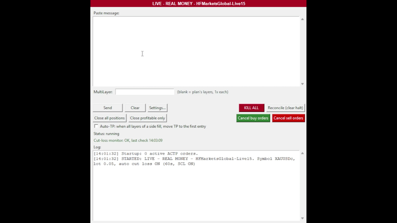

🇬🇧 [English](README_gb.md)

# ACTP – Auto Copy Trade Plan

<p align="center">
    
</p>

ACTP memasang sekumpulan order pending MT5 berlapis dari trade plan yang Anda tempel (atau Anda isi manual di tab **Manual Input**), lalu mengelola setiap plan sesudahnya (Cut Loss, tombol close, Auto-TP). ACTP tidak membaca WhatsApp untuk Anda: Anda menyalin dan menempel setiap pesan sendiri.

> [!WARNING]
> ACTP memasang **order sungguhan** pada akun MetaTrader 5 yang sedang login dan dapat menyebabkan kerugian. Aplikasi ini disediakan **TANPA GARANSI** (lihat file LICENSE). Ini bukan saran keuangan dan tidak berafiliasi dengan penyedia sinyal, WhatsApp, MetaQuotes, maupun broker mana pun. Anda bertanggung jawab atas setiap order. Uji dulu di akun demo.

## 🎬 Video tutorial

<p align="center">
  <a href="https://youtu.be/d0bM5Vmml2w">
    
  </a>
</p>

> Video ini menampilkan v1.0.2. Lihat [CHANGELOG.md](CHANGELOG.md) untuk yang baru di v2.0.0.

## 💻 Persyaratan

Sebelum memasang ACTP, pastikan Anda memiliki:

- Windows 10 atau Windows 11 (64-bit).
- Terminal desktop MetaTrader 5.
- Akun MT5 **hedging**. Pada akun netting, layer di satu sisi akan menyatu menjadi satu posisi. ACTP menolak berjalan di akun netting.
- Algo Trading dalam keadaan AKTIF (ON) di toolbar MT5.
- MT5 harus terbuka dan sudah login selama ACTP berjalan.
- Broker Anda menyediakan simbol XAUUSD (XAUUSD, XAUUSDc, XAUUSDm, XAUUSD.r, dan seterusnya).

## 📥 Unduh

Unduh rilis ACTP terbaru dari halaman GitHub Releases resmi:

**[KLIK DI SINI UNTUK MENGUNDUH ACTP – RILIS TERBARU](https://github.com/ALtera21/ACTP/releases/download/v2.0.0/dist.zip)**

1. Unduh file `.zip` yang tersedia di bagian **Assets**.
2. Ekstrak file ZIP ke folder pilihan Anda.
3. Jalankan `ACTP.exe` dari folder hasil ekstrak. Biarkan tetap bersama folder `_internal`; jangan memindahkan exe ke tempat lain atau menjalankannya dari dalam ZIP.

> **Catatan:** Windows SmartScreen dapat memperingatkan tentang aplikasi yang tidak ditandatangani: “More info → Run anyway”. Exe buatan PyInstaller juga sering memicu false positive antivirus.

Contoh:

```text
C:\ACTP
```

**Verifikasi unduhan Anda (v2.0.0):** di PowerShell jalankan
```powershell
Get-FileHash .\dist.zip -Algorithm SHA256
```
lalu bandingkan dengan: `b89dd2ade0134dd01b9cbbb18d988cd0cda687c371f3accf1f354da55c42ea8f`

**Memperbarui dari v1.1.0:** tutup ACTP, ekstrak v2.0.0 ke folder baru lalu jalankan. Pengaturan dan state tersimpan Anda di `%APPDATA%\ACTP` tetap terbawa. Plan yang masih terbuka dari v1.1.0 tetap memakai Cut Loss hold-timer yang lama.

## 🚀 Pengaturan ACTP

1. Buka MetaTrader 5, login, dan aktifkan **Algo Trading**.
2. Klik dua kali `ACTP.exe`.
3. **Hanya saat pertama kali dijalankan:** baca pemberitahuan risiko lalu klik OK. Jendela Settings akan terbuka:
   - Pilih simbol XAUUSD broker Anda (**Detect from MT5** mengisi daftar).
   - Pilih opsi Cut Loss Anda (lihat di bawah).
   - Centang **Create a desktop shortcut** jika Anda mau.
   - Klik **Save**. ACTP akan restart sendiri.
4. Banner di jendela menunjukkan akun yang sedang dipakai: **biru tua = LIVE (uang sungguhan)**, **hijau = DEMO**, beserta nama server. Cobalah dulu di akun demo.
5. Atur **Lot** dan timeframe **Candle** di jendela utama, salin trade plan dari WhatsApp, tempel ke kotak, klik **Send**, baca ringkasannya, lalu konfirmasi.

Pengaturan, log, dan plan tersimpan Anda ada di `%APPDATA%\ACTP` (`settings.json`, `logs\`, `state\`). Untuk menghapus instalasi, hapus folder ACTP dan `%APPDATA%\ACTP`.

**Penting:** pengaturan hanya dapat disimpan saat MT5 terbuka, karena ACTP memeriksa simbol dan lot terhadap broker Anda.

## 🖥️ Menggunakan ACTP

### Pesan yang dipahami ACTP

| Pesan | Yang dilakukan ACTP |
|---|---|
| `PLAN XAUUSDr` dengan bagian BUY LIMIT dan/atau SELL LIMIT | Memulai **plan baru** dan memasang satu order pending per layer. Plan lama **tidak** diganti; setiap plan berdiri sendiri. |
| `UPDATE XAUUSDr BUY\|SELL` dengan `SL: a ➜ b` dan/atau `TP: a ➜ b` | Mengubah SL/TP di sisi tersebut pada plan **terbaru** yang memilikinya. |
| `CLOSE XAUUSDr BUY\|SELL` | Menutup **posisi terbuka** di sisi tersebut pada semua plan. Order pending di sisi itu tetap ada. |
| `XAUUSDr BUY\|SELL - Entry ter-fill` | Hanya dicatat. Tidak ada yang dikirim. |

Batas: 2 sampai 200 layer per sisi, maksimal 400 order per plan, harga dengan 2 desimal. Menempel teks yang persis sama dua kali dalam 30 detik akan ditolak.

### Kontrol jendela

| Kontrol | Fungsinya |
|---|---|
| Tab **Paste message** | Tempat Anda menempel pesan. |
| Tab **Manual Input** | Membuat plan secara manual (lihat "Manual Input" di bawah). |
| Kotak **MultiLayer** | Opsional. Menentukan pengali lot tiap layer dan jumlah layer untuk plan yang Anda kirim berikutnya (lihat "MultiLayer" di bawah). |
| **Layer amount** | Jumlah layer untuk plan berikutnya saat MultiLayer kosong (2 sampai 200). |
| **Lot** | Lot dasar setiap order. Perubahan langsung berlaku dan disimpan. Nilainya diperiksa terhadap minimum, step, dan maksimum broker Anda. |
| **Candle** | Timeframe candle untuk Cut Loss pada plan yang Anda kirim mulai sekarang (M1 sampai H1). Plan yang sudah terkirim tetap memakai timeframe-nya. Abu-abu (nonaktif) bila auto cut loss mati atau timer lama dipakai. |
| ☾ / ☀ | Berpindah antara tema terang dan gelap (berlaku setelah restart). |
| **Send** | Mem-parse pesan, menampilkan ringkasan (termasuk berapa layer yang akan langsung terisi di harga market saat ini), dan mengirimnya setelah Anda konfirmasi. |
| **Clear** | Mengosongkan kotak tempel. |
| **Settings...** | Membuka jendela pengaturan. Perubahan berlaku setelah restart (ACTP menawarkannya). |
| **Reconcile (clear halt)** | Setelah operasi gagal, ACTP berhenti (status menunjukkan HALTED). Periksa MT5, tekan tombol ini untuk membacanya ulang, lalu Send pesan yang sama lagi untuk melanjutkan. (Anggap ini sebagai tombol refresh.) |
| **KILL ALL** | Membatalkan setiap order pending ACTP dan menutup setiap posisi terbuka ACTP, di semua plan. |
| **Close all positions** | Hanya menutup posisi terbuka. Order pending tetap ada. |
| **Close profitable only** | Hanya menutup posisi yang sedang profit. Spread dihitung; swap dan komisi tidak. |
| **Cancel buy orders** / **Cancel sell orders** | Membatalkan order **pending** di sisi tersebut pada semua plan. Posisi terbuka tetap terbuka dan mempertahankan SL/TP serta perlindungan Cut Loss-nya. Tidak berjalan saat HALTED: tekan Reconcile dulu. |
| Kotak centang **Auto-TP** | Saat semua layer di satu sisi sebuah plan sudah terisi, TP plan itu di sisi tersebut dipindah ke entri pertamanya, alias `proximal` (BUY: layer tertinggi, SELL: layer terendah). Sekali per plan dan per sisi. Selalu OFF setiap kali ACTP dimulai. |

Sebagian besar tombol ini meminta konfirmasi terlebih dulu; lihat "Popup konfirmasi" di bawah.

> [!NOTE]
> ACTP hanya menyentuh order yang dipasangnya sendiri. Trade manual Anda tidak pernah diubah.

<p align="center">
  
</p>

<p align="center">
  
</p>

### Live plans

Setiap plan yang Anda kirim mendapat nama: **Alpha, Beta, Gamma … Omega** (lalu id acak yang pendek). Tabel **Live plans** menampilkan satu baris per plan berisi waktu kirim, order BUY dan SELL (terisi / pending, Cut Loss), serta hitung mundur candle-nya. Nama yang sama ada di komentar order MT5, misalnya `1763440000-Alpha:3` (waktu kirim, nama plan, nomor layer).

Setiap baris memiliki tombol kecil (arahkan kursor untuk membaca fungsinya):

| Tombol | Fungsinya |
|---|---|
| **✕** hijau di samping BUY | Membatalkan order pending BUY plan itu dan menutup posisi BUY yang terbuka. |
| **✕** merah di samping SELL | Sama, untuk SELL. |
| **✕** gelap di ujung baris | Membatalkan seluruh plan dan menutup semua posisinya. |

Plan lain tidak pernah tersentuh. Tombol-tombol ini tetap berfungsi saat ACTP berstatus HALTED.

**Kotak timer** di sebelah baris status menampilkan timeframe yang dipakai, sisa waktu sampai candle close, dan nama plan. Angkanya berubah dari hijau ke kuning lalu merah saat candle hampir close. Kotak ini juga berjalan ketika tidak ada plan yang live (saat itu menampilkan timeframe yang akan dipakai plan berikutnya).

### Manual Input

Tab **Manual Input** memungkinkan Anda membuat plan tanpa pesan WhatsApp. Isi **range** (dua harga) untuk sisi yang Anda inginkan, SELL di atas dan BUY di bawah; sisi dengan range kosong dilewati. Biarkan **Cut loss**, **Stop loss**, atau **Take profit** kosong untuk memakai nilai default yang tampil di sebelah kotaknya:

| Harga | Default |
|---|---|
| Cut loss | 30% dari lebar range, di luar ujung terjauh range |
| Stop loss | **Manual SL = x range** (Settings, default 3) kali lebar range, di luar ujung terjauh |
| Take profit | Sejauh satu lebar range melewati layer teratas |

Layer dan lot berasal dari kotak **Layer amount** dan **MultiLayer**. Tab ini menulis teks `PLAN` biasa dan mengirimkannya melalui pemeriksaan yang sama seperti pesan yang ditempel, sehingga Anda mendapat ringkasan dan popup konfirmasi yang sama.

<p align="center">
  
</p>

### MultiLayer

Kotak **MultiLayer** di bawah kotak tempel memungkinkan Anda menentukan ukuran setiap layer, dan jumlah layer, untuk plan yang Anda kirim berikutnya. Ketik satu angka per layer, misalnya `1, 1, 1, 1, 2, 2`. Setiap angka mengalikan **Lot** (lot dasar).

| Lot dasar | MultiLayer | Hasil |
|---|---|---|
| 0.06 | `1, 1, 1, 1, 2, 2` | 6 layer: 0.06 x 4, lalu 0.12 x 2 |
| 0.06 | `1, 1, 1, 2` | 4 layer: 0.06 x 3, lalu 0.12 x 1 |

<p align="center">
  
</p>

> GIF ini menampilkan v1.0.2. Lihat [CHANGELOG.md](CHANGELOG.md) untuk yang baru di v2.0.0.

- **Layer 1 adalah harga pertama yang dicapai market** (BUY: entri tertinggi, SELL: entri terendah). Lot yang lebih besar pada contoh di atas adalah layer terdalam.
- Daftar ini juga menentukan jumlah layer. ACTP membagi sejumlah layer itu secara merata di seluruh area plan, berapa pun jumlah layer yang tertulis di pesan.
- **Biarkan kotak kosong** dan ACTP memakai kotak **Layer amount**: sejumlah layer tersebut, masing-masing satu lot dasar (atau **Saved MultiLayer** Anda untuk jumlah itu, lihat di bawah).
- Daftar yang sama dipakai untuk BUY dan SELL. Daftar ini diabaikan oleh pesan UPDATE dan CLOSE.
- Gunakan 2 sampai 200 angka, masing-masing di atas 0 dan paling besar 10. Desimal seperti `1.5` boleh asalkan lot hasilnya kelipatan 0.01. Sebuah plan dapat memuat paling banyak 400 order secara total.
- Ringkasan Send mencantumkan lot setiap layer dan total per sisi. ACTP juga memeriksa lot terhadap minimum, step, dan maksimum broker Anda sebelum apa pun dikirim.
- Kotak ini **tidak disimpan** dan **tidak dikosongkan setelah Send**. Selama terisi, sebuah baris oranye di bawahnya menampilkan lot yang akan dipakai.
- Jika sebuah plan terhenti (HALTED), Send pesan yang sama lagi dengan nilai MultiLayer yang **sama** untuk melanjutkannya. Nilai yang berbeda akan memulai plan baru.
- **Max layers at market per side** menghitung layer, bukan lot, jadi layer besar dihitung sama dengan layer kecil.

**Saved MultiLayer** (Settings → **Saved MultiLayer...**): simpan sebuah daftar untuk jumlah layer tertentu, misalnya 4 layer = `1, 1, 1, 2`. Setiap kali kotak MultiLayer kosong dan Layer amount adalah 4, daftar itulah yang dipakai. Jumlah layer yang tidak punya daftar tersimpan memakai 1x untuk setiap layer. Daftar yang diketik di kotak MultiLayer selalu diutamakan.

### Plan terlambat

Jika Anda menempel plan setelah harga sudah bergerak masuk ke areanya, layer yang entrinya sudah tercapai dibeli **di harga market** alih-alih gagal. Ringkasan Send menampilkan pembagiannya. Plan ditolak apabila:
- lebih banyak layer daripada **Max layers at market per side** yang akan terisi di harga market, atau
- harga sudah menembus Cut Loss atau SL di sisi tersebut.

### Cut Loss

Dengan **Auto cut loss** aktif, ACTP menutup satu sisi penuh sebuah plan (membatalkan pending, menutup yang terbuka) begitu aturan di bawah ini terpenuhi. Setiap plan menyimpan aturan dan timeframe yang dipakai saat dikirim, jadi mengubah pengaturan di kemudian hari tidak mengubah plan yang sudah live.

**Candle close (default).** Sebuah candle pada timeframe pilihan Anda harus **close** melewati Cut Loss plan (BUY: di bawahnya, SELL: di atasnya). Hanya candle yang dibuka **setelah** plan dikirim yang dihitung, dan lonjakan harga yang kembali sebelum candle close tidak berpengaruh apa pun. Pilih timeframe di kotak **Candle** (M1, M2, M3, M4, M5, M6, M10, M12, M15, M20, M30, H1). Kotak timer menghitung mundur sampai close candle yang sedang berjalan. Hitung mundur mengikuti tick harga terakhir, sehingga bisa meleset beberapa detik saat market sepi atau tutup.

**Timer lama / Legacy timer (opsional).** Centang **Use the legacy timer instead** di Settings untuk kembali ke aturan v1:
1. harga (BUY: bid, SELL: ask) bertahan melewati Cut Loss plan selama **hold time** tanpa terputus, **dan**
2. dengan **SCL** aktif, harga juga berada di atau melewati garis Stop Cut Loss pada saat itu.

SCL berada di antara Cut Loss dan SL, pada persentase yang dipilih dari jarak Cut Loss ke SL. Jeda lebih dari 15 detik antar pengecekan harga akan mengulang timer dari awal.

Dengan auto cut loss **mati**, tidak ada yang menutup sisi secara otomatis: hanya SL/TP broker, KILL ALL, atau Anda sendiri.

**Cut Loss dan Auto-TP hanya berjalan selama jendela ACTP terbuka.** Menutupnya akan meminta konfirmasi, karena pemantauan berhenti. Order tetap memiliki SL/TP di sisi broker.

### Popup konfirmasi

Settings memiliki kotak merah **Popup configurations (Dangerous settings)**. **Popup confirmation** adalah saklar utama dan **Configure each popup...** membuka satu kotak centang per aksi: Send plan, Cancel PO buy / sell, KILL ALL, Close all positions, Close profitable only, tombol-tombol tabel plan, dan Quit. Semuanya tercentang secara default, artinya popup OK / Cancel yang normal.

**Menghapus centang** sebuah kotak (atau kotak utama) akan lebih dulu meminta Anda mengetik kode acak 5 digit. Setelah itu, aksi langsung berjalan **tanpa popup sama sekali**, jadi lakukan ini hanya jika Anda menerima risiko salah klik. Mencentang kembali tidak memerlukan kode.

### Bahasa dan tema

- **Bahasa:** Settings → **Language**: English atau Bahasa Indonesia. Berlaku setelah restart. Teks error terperinci dari broker dan parser tetap dalam bahasa Inggris.
- **Tema:** tombol ☾ / ☀ di sebelah kanan baris Layer amount untuk berpindah antara terang dan gelap. Berlaku setelah restart.

### Logo

Logo di title bar dan taskbar diatur di `logo.py` (berkas gambar atau emoji). Untuk mengubah ikon `.exe` juga, lihat `make_icon.py` (petunjuk build ada di baris-baris pertamanya).

## 📋 Konfigurasi Trading

Atur ini di **Settings...** (atau di jendela utama bila disebutkan). Nilai default ditampilkan.

| Pengaturan | Default | Yang diizinkan | Arti |
|---|---|---|---|
| Simbol XAUUSD | `XAUUSDc` | Varian XAUUSD apa pun (`XAUUSD`, `XAUUSDm`, `XAUUSD.r`, ...) | Satu-satunya simbol yang akan ditradingkan ACTP. Pesan selalu menulis `XAUUSDr`; itu nama dari penyedia, bukan nama simbol Anda. |
| Lot (jendela utama) | 0.01 | 0.01 sampai 10, kelipatan 0.01 | Volume setiap layer (lot dasar yang dikalikan MultiLayer). Harus sesuai batas broker Anda. |
| Layer amount (jendela utama) | 6 | 2 sampai 200 | Jumlah layer plan berikutnya saat MultiLayer kosong. |
| Candle (jendela utama) | M1 | M1 sampai M6, M10, M12, M15, M20, M30, H1 | Timeframe candle untuk Cut Loss pada plan baru. |
| Max layers at market per side | 3 | 0 sampai 200 | Lihat "Plan terlambat". |
| Manual SL = x range | 3 | 0.1 sampai 100 | Jarak Stop loss default untuk tab Manual Input. |
| Auto cut loss | On | On / Off | Lihat "Cut Loss". |
| Use the legacy timer | Off | On / Off | Memakai aturan hold-timer + SCL sebagai ganti candle. |
| Hold time | 60 s | 10 sampai 3600 | Hanya timer lama: berapa lama pelanggaran Cut Loss harus bertahan. |
| SCL | On | On / Off | Hanya timer lama: harga juga harus mencapai garis Stop Cut Loss. |
| SCL distance | 15 % | 5 sampai 95 | Hanya timer lama: seberapa jauh garis SCL dari Cut Loss ke arah SL. |
| Popup confirmation | Semua On | per aksi | Lihat "Popup konfirmasi". |
| Language | English | English / Bahasa Indonesia | Bahasa jendela. |

Simbol Anda harus memiliki minimal 2 desimal harga.

<p align="center">
  
</p>

> **Catatan:**
Ukuran lot yang tertera di trading plan WhatsApp aslinya diabaikan. ACTP memakai volume yang dikonfigurasi sendiri.

## ⚠️ Catatan Penting

- ACTP tidak memiliki mode dry-run. Uji dulu di akun demo, satu salinan per akun, biarkan PC tetap menyala dan jendela tetap terbuka, periksa banner dan server, risiko ditanggung Anda sendiri.
- Pastikan terminal MT5 Anda terhubung ke akun trading yang benar.
- Jangan pernah memakai rilis yang belum diverifikasi untuk trading live.
- Trading mengandung risiko keuangan. Anda bertanggung jawab untuk mengonfigurasi dan memantau lingkungan trading Anda.

## 🐛 Pemecahan Masalah

| Pesan | Yang harus dilakukan |
|---|---|
| `Cannot start: ...` | Buka MetaTrader 5, login, aktifkan Algo Trading, lalu jalankan ACTP lagi. |
| `Cannot read your settings file` | Perbaiki atau hapus `%APPDATA%\ACTP\settings.json`. |
| `Status: HALTED` | Periksa MT5, tekan **Reconcile**, lalu Send pesan yang sama lagi untuk melanjutkan. Untuk menyingkirkan satu plan, gunakan tombol **✕** gelapnya di tabel Live plans. |
| Windows memblokir aplikasi | More info → Run anyway (lihat Unduh). |
| This account is not a HEDGING account | Gunakan akun hedging. Tanyakan ke broker Anda. |
| Logo tidak berubah | Restart ACTP. Logo emoji membutuhkan Pillow; gunakan file PNG sebagai gantinya (lihat `logo.py`). |

**Log:** ACTP menulis satu file log per hari ke `%APPDATA%\ACTP\logs\actp.log` (disimpan 30 hari). Tempel `%APPDATA%\ACTP\logs` ke address bar File Explorer untuk membuka foldernya. Jika Anda melaporkan masalah, lampirkan baris yang relevan. Baris-baris itu berisi nama server broker, tiket order, dan harga, jadi periksa dulu sebelum memostingnya secara publik.

Bug dan pertanyaan: buka issue di repositori GitHub.

## 📄 Lisensi

Lihat file LICENSE di repositori untuk ketentuan lisensi dan penggunaan.
